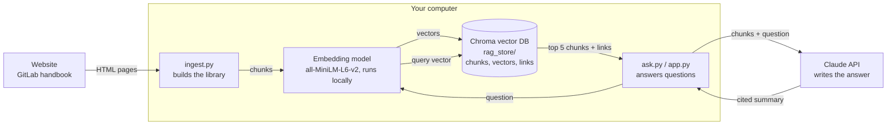
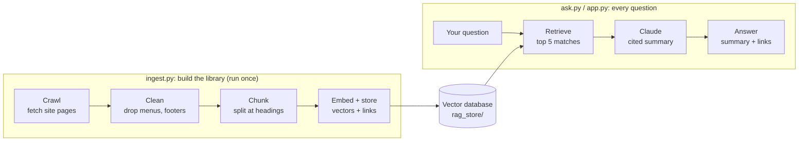

# Site Q&A with RAG — a learning build

Ask questions in plain English about a public website. The bot answers with a short
summary and links to the exact sections it used.

The default source is GitLab's public company handbook (people policies, time off,
benefits). It is a good stand-in for an internal Confluence space. To use any other
site, edit `config.py`.

## Architecture



| Component | Role | Why it's there |
|---|---|---|
| `ingest.py` | Crawls, cleans and chunks pages, then stores them | Builds the searchable library ahead of time |
| Embedding model | Turns text into 384 numbers that capture meaning | Matches by meaning: "vacation" finds "paid time off". Free, and nothing leaves your computer |
| Chroma vector DB | Stores each chunk with its vector and link | Finds the closest chunks in milliseconds; keeps the source link next to the text |
| `ask.py` / `app.py` | Embeds the question, retrieves, prompts Claude, attaches links | The question-answering loop (terminal and chat page) |
| Claude API | Writes a short summary citing [1], [2]… | The only step that leaves your computer, and it only receives the 5 retrieved chunks |

The key design choice: **search finds the facts, and the LLM only writes the summary.**
Links come from the stored metadata, never from the model, so they can't be invented.
The same embedding model is used for chunks and questions, so their vectors are
comparable.

### Data flow



> Built with help from Claude (Anthropic); run, tested and extended by me.

---

## 1. Run it (about 10 minutes)

**Requirements:** Python 3.9 or newer. An Anthropic API key is optional; without
one you still get retrieval and links, just no written summary.

macOS / Linux:
```bash
git clone https://github.com/chitanya-chitturi/website-rag-assistant.git
cd website-rag-assistant
python3 -m venv .venv
source .venv/bin/activate          # prompt now starts with (.venv)
pip install -r requirements.txt

python ingest.py --reset           # Stage 1: build the index (add --max-pages 20 for a quick test)
python ask.py --show-chunks "How much paid time off do employees get?"
streamlit run app.py               # chat UI at http://localhost:8501
```

Windows (PowerShell): use `python` instead of `python3`, and activate with
`.venv\Scripts\Activate.ps1`.

In every new terminal window, `cd` into the folder and run the `activate` line again.

### Adding your Anthropic API key (for written answers)

Create a key at [console.anthropic.com](https://console.anthropic.com) under **API Keys**.
**Never put the key in `config.py` or any file in this repo**, because it would be
published to GitHub.

```bash
# This terminal window only:
export ANTHROPIC_API_KEY=sk-ant-...

# Or permanently on macOS (saved in your home folder, outside the repo):
echo 'export ANTHROPIC_API_KEY=sk-ant-...' >> ~/.zshrc && source ~/.zshrc
```
On Windows PowerShell: `$env:ANTHROPIC_API_KEY = "sk-ant-..."`

### Querying

| Command | What you get |
|---|---|
| `python ask.py "question"` | Answer + source links |
| `python ask.py --show-chunks "question"` | The above, plus the 5 retrieved chunks and their distances |
| `python ask.py --no-llm "question"` | Chunks and links only, with no Claude call |
| `streamlit run app.py` | Chat page; the sidebar shows the retrieved chunks |

The first `ingest.py` run downloads the embedding model (about 80 MB, one time only).
Crawling 150 pages then takes a few minutes, because the crawler waits one second
between requests to be polite to the site.

---

## 2. What RAG is, in one paragraph

An LLM doesn't know your site, and if you just ask it, it may confidently make an
answer up. **Retrieval-Augmented Generation** fixes this in two moves. First,
**retrieve** the few passages from your documents that are relevant to the question.
Then hand the LLM only those passages, with the instruction "answer from these,
cite them." The LLM's job changes from *remembering* to *reading and summarizing*,
and that is something it does very reliably.

There are two pipelines:

| Stage | File | When it runs | What it does |
|---|---|---|---|
| Indexing | `ingest.py` | Once, then on a schedule | crawl → clean → chunk → embed → store |
| Answering | `ask.py` / `app.py` | Every question | embed question → retrieve → prompt LLM → answer + links |

---

## 3. Stage 1, step by step (`ingest.py`)

### Step 1 — Crawl
Starting from `START_URLS`, the crawler downloads each page, collects its links, and
queues the ones that begin with an `ALLOWED_PREFIXES` entry. This is a breadth-first
search capped at `MAX_PAGES`. It reads `robots.txt` first and skips anything the site
asks bots not to fetch. It also normalizes URLs by stripping `#fragment`, `?query` and
`index.html`, so the same page isn't stored twice under two addresses.

### Step 2 — Clean
Raw HTML is mostly noise: menus, footers and scripts. If you leave those in, every
chunk contains "Home · About · Login" and retrieval gets worse. So the code removes
`nav`, `header`, `footer`, `script` and similar elements, then keeps only `<main>` or
`<article>`. Two details make a big difference:
- **Tables become `cell | cell | cell` lines.** Holiday calendars and benefit
  tables stay readable, instead of turning into a jumble of words.
- **The page is split at its h1–h3 headings.** Each heading's `id` is kept, so a
  source link can jump straight to `page#company-holidays` instead of the top of
  a long page.

### Step 3 — Chunk
Embeddings work best on focused pieces of text. A whole page covers too many topics,
and a single sentence has too little context. Each heading section becomes a chunk.
Long sections are cut into pieces of about 1,200 characters, with a 200-character
overlap. The overlap means a fact sitting on a cut line still appears whole in at
least one piece.

Every chunk also gets a **contextual header** at the top: `Page title > Section heading`.
A chunk that just says "16 weeks, fully paid" now also says *Parental leave*, so it
can be found by that topic. This one trick often improves retrieval more than
switching to a fancier model.

### Step 4 — Embed
Each chunk goes through an embedding model (`all-MiniLM-L6-v2`, run locally), which
turns it into 384 numbers that represent its meaning. Texts with similar meanings get
similar numbers. For example, "vacation days" and "paid time off" end up close
together even though they share no words. That is the difference from keyword search.

### Step 5 — Store
The vectors, the text, and the **metadata** (URL, deep link, title, section) are
stored in Chroma, a vector database that lives in the `rag_store/` folder. Re-running
ingest deletes each page's old chunks before adding new ones, so edited pages don't
leave stale pieces behind.

Then open `data/chunks.jsonl` and read some chunks yourself. If a chunk looks like
garbage to you, it will retrieve badly too.

---

## 4. Stage 2, step by step (`ask.py`)

### Step 6 — Retrieve
The question is embedded with the **same** model, and Chroma returns the `TOP_K`
nearest chunks along with a **distance** for each (0 = same meaning; larger values
mean less related). Chunks beyond `MAX_DISTANCE` are dropped, so a question the site
can't answer gets "not found" instead of a stretch.

### Step 7 — Augment
The surviving chunks are numbered `[1]`…`[5]` and placed into the prompt. The system
prompt sets the rules: use only these excerpts, cite numbers, say so if the answer
isn't there, and treat excerpt text as data rather than instructions. That last rule
is a basic defense against prompt injection hidden in web pages.

### Step 8 — Generate
Claude writes a short, cited summary.

### Step 9 — Attach links
The code reads which `[n]` numbers the answer cited and looks up those chunks' links
**from the stored metadata**. The model never types a URL, so it can't invent one.
This is why the links can be trusted.

---

## 5. Experiments to learn from

1. **Watch the distances.** Run `python ask.py --show-chunks "..."` on a question the
   site answers and on one it doesn't, such as "best pizza recipe". Compare the
   distances, then set `MAX_DISTANCE` between the two.
2. **Change chunk size.** Try 400 and 3000 in `config.py`, run `ingest.py --reset`,
   and ask the same questions. Small chunks lose context; big ones blur topics.
3. **Remove the contextual header** in `make_chunks()` and see which questions stop
   finding the right chunk.
4. **Ask with different words.** Try "PTO", "vacation" and "annual leave". This is
   where semantic search beats keyword search, and also where it sometimes fails
   on exact codes and names. That failure is the motivation for *hybrid search*,
   covered in the next steps below.
5. **Point it at another site.** Change `START_URLS` and `ALLOWED_PREFIXES` and run
   `ingest.py --reset`.

---

## 6. Where this goes next

- **Hybrid search:** combine keyword (BM25) and vector scores so exact terms such as
  policy codes and product names also match well.
- **Reranking:** retrieve 20 chunks, then have a reranker model pick the best 5.
- **Evaluation:** write 20 questions with known answer URLs and measure how often
  the right link comes back. Change one thing at a time.
- **Agentic RAG:** let the LLM decide when to search, rewrite the query, or search
  again when the first results are weak.
- **Confluence:** replace `crawl()` with the Confluence REST API. Everything after
  Step 2 stays the same.
- **Azure version:** Azure AI Search as the index (with built-in hybrid search) plus
  Azure OpenAI. The concepts are identical; only the services change.

## Files

```
config.py        all settings (site, chunk size, top-k, model)
store.py         opens the Chroma vector DB with the embedding model
ingest.py        Stage 1: crawl → clean → chunk → embed → store
ask.py           Stage 2: retrieve → prompt → answer + links (CLI)
app.py           chat web UI (Streamlit) with a retrieved-chunks panel
data/chunks.jsonl  written by ingest.py; what the bot searches
rag_store/       written by ingest.py; the vector database
```
